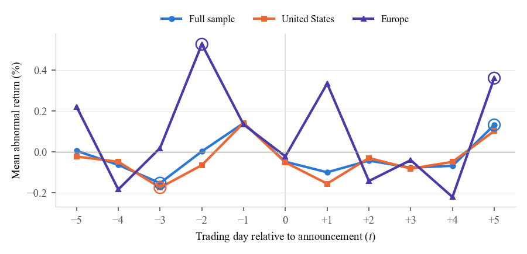
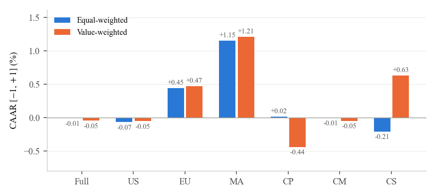
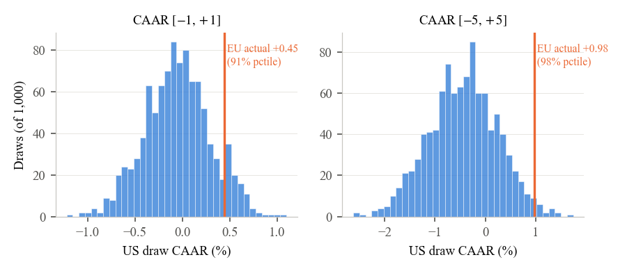
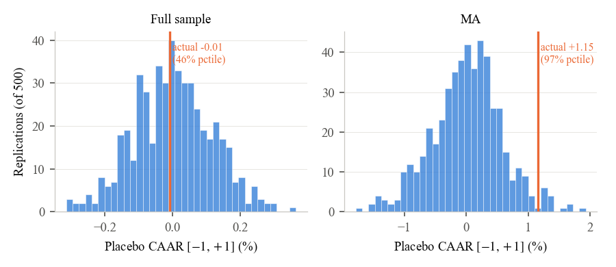

# Do US and European Equity Markets Price AI Announcements Differently?

Code for the empirical part of the master thesis *Do United States and European Equity Markets Price Artificial Intelligence Announcements Differently? Evidence from an International Event Study* (University of St.Gallen, Master in Quantitative Economics and Finance).

The thesis studies 615 AI-related entries in the Bloomberg corporate-events calendar for S&P 500 and STOXX Europe 600 firms between 2018 and May 2026 (545 US, 70 European, 174 firms). It asks three questions:

1. Do AI announcements generate abnormal returns?
2. Do US and European markets price them differently?
3. Does volatility respond differently across the two regions?

## Methods

**Abnormal returns.** Each event has its own Fama-French five-factor regression, estimated over $\tau \in \{-250, \ldots, -20\}$ trading days with region-matched factors (US factors for S&P 500 firms, European factors for STOXX Europe 600 firms),

```math
R_{it} - R_{ft} = \alpha_i + \beta_{1i}\,MKT_t + \beta_{2i}\,SMB_t + \beta_{3i}\,HML_t + \beta_{4i}\,RMW_t + \beta_{5i}\,CMA_t + \varepsilon_{it}.
```

The abnormal return $AR_{it}$ is the realised minus the fitted excess return on event day $t$, and $CAR_i(t_1,t_2)=\sum_{t=t_1}^{t_2} AR_{it}$. FF3 and the market model are robustness checks.

**Inference.** The BMP test is applied to standardised CARs whose denominator includes the forecast-error term. Events share calendar dates only in part, so the Kolari-Pynnönen correction for cross-sectional correlation is scaled by the number of ordered same-date event pairs $S=\sum_d n_d(n_d-1)$,

```math
t_{KP} = t_{BMP}\sqrt{\frac{1-\bar\rho\,S/\big(N(N-1)\big)}{1+\bar\rho\,S/N}}.
```

The average correlation $\bar\rho$ is the mean correlation of estimation-window residuals across same-date event pairs, and the correction applies only when $\bar\rho > 0$. Benjamini-Hochberg $q$-values control the false discovery rate across the seven event windows within the full sample, the US and Europe, and across the 12 sector-by-window tests.

**US versus Europe.** The regional comparison uses 1,000 random draws of 70 US events, a matched comparison by event type, firm size and year, a regression of CARs on an EU dummy with controls, and an event-time panel with firm-event fixed effects $\mu_i$,

```math
AR_{it} = \sum_{m\neq -1}\gamma_m D_{t=m} + \sum_{m\neq -1}\delta_m \left(D_{t=m}\times EU_i\right) + \mu_i + \varepsilon_{it}.
```

Standard errors are clustered by firm and calendar date.

**Volatility.** The variance ratio $VR_i=\sum_{t=-1}^{+1}AR_{it}^2/(3\hat\sigma_i^2)$ is regressed on an EU dummy and $\hat\sigma_i$. A GARCH(1,1) model is fitted to each firm's daily returns, and the normalised excess variance $z^2_{it}=\hat\varepsilon^2_{it}/\hat\sigma^2_{it}-1$ is regressed on the announcement indicator $A_{it}$ and $A_{it}\times EU_i$ with firm and calendar-date fixed effects.

## Results

After accounting for market and risk factors, AI announcements have no detectable effect on stock prices over a three-day window. Over wider windows of seven to eleven trading days, US announcements show a negative drift in cumulative abnormal returns of around 0.4 per cent. The drift disappears when each firm is weighted equally. European announcements show higher average cumulative abnormal returns than US announcements in every event window, but the difference is not statistically significant.

| | N | $[-1,+1]$ | $[0,+3]$ | $[-3,+3]$ | $[-5,+5]$ |
|---|---|---|---|---|---|
| Full sample | 615 | −0.01 (0.501) | −0.27 (0.037) | −0.28 (0.014) | −0.28 (0.027) |
| United States | 545 | −0.07 (0.446) | −0.32 (0.041) | −0.42 (0.006) | −0.44 (0.013) |
| Europe | 70 | +0.45 (0.887) | +0.13 (0.635) | +0.81 (0.715) | +0.98 (0.669) |

Equal-weighted CAAR in per cent, KP-corrected $p$-value in parentheses (Table A1 of the thesis).









## Repository

```
01_sample_and_abnormal_returns.ipynb   sample construction, earnings screen, FF5 abnormal returns (filter counts of Table 3.1, Tables 3.2, 3.4)
02_abnormal_returns.ipynb              CAAR tests, daily ARs, clustering, tiers, firm-level tests (Tables 5.1 to 5.3, 5.9, 5.11, A1, A2)
03_us_vs_europe.ipynb                  subsampling, matching, CAR regression, event-time panel (Tables 5.4, 5.5, A6 to A8)
04_volatility.ipynb                    variance ratios, GARCH(1,1) (Tables 5.6, A9)
05_robustness.ipynb                    benchmark models, time split, estimation-window contamination, placebo, outliers, sectors, earnings inside the window (Tables 5.7, 5.8, 5.10, 5.12, A3 to A5)
06_firm_classification.ipynb           firm descriptives, AI-announcer classification (Tables 3.3, 4.1, 4.2)
07_tables_and_figures.ipynb            LaTeX table bodies and Figures 5.1 to 5.6
src/common.py                          data loaders and test statistics shared by the notebooks
data/README.md                         the inputs the notebooks need
figures/                               figures (PDF and PNG)
```

## Data

The Bloomberg Terminal and WRDS data are licensed and not included. The factor files of the Ken French Data Library are public. [data/README.md](data/README.md) describes the inputs and their sources. With these inputs, the notebooks reproduce the results reported in the thesis.

Wharton Research Data Services (WRDS) was used in preparing this repository. This service and the data available thereon constitute valuable intellectual property and trade secrets of WRDS and/or its third-party suppliers. This data and information is based on data from the Center for Research in Security Prices, LLC (CRSP), © 2026.

## Running

Python 3.12.

```bash
pip install -r requirements.txt
jupyter lab
```

Run the notebooks in order from the repository root. Notebook 01 writes the event sample that the others read. Inputs are read from `DATA_DIR` (default `data/`, see [data/README.md](data/README.md)). Tables are written to `OUTPUT_DIR` (default `output/`) and figures to `figures/`.
